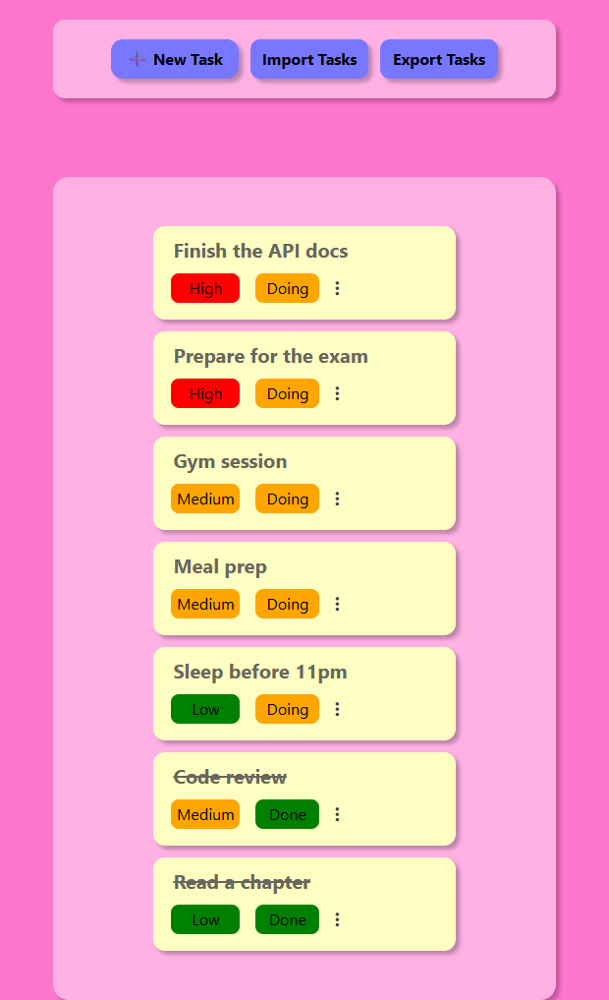

# ToDo App

A simple to-do list / task manager web app written in **plain PHP** with **MySQL** (PDO) and styled with **Tailwind CSS**. Create, view, edit, and delete tasks with priorities, progress status, and due dates, and import or export your tasks as CSV.

<p align="center">
  
</p>

## Features

- **Full CRUD** for tasks through modal dialogs (create, view details, edit, delete)
- **Task attributes**: title, description, due date, priority (`Low` / `Medium` / `High`), and progress (`Doing` / `Done`)
- **Smart ordering**: tasks in progress come first, sorted by priority; completed tasks are struck through
- **Color-coded badges** for priority and progress
- **CSV export** of all tasks with one click
- **CSV import** to bulk-create tasks from a file
- Prepared statements (PDO) and output escaping with `htmlspecialchars`

## Tech Stack

| Layer    | Technology |
| -------- | ---------- |
| Backend  | PHP (procedural) with PDO |
| Database | MySQL / MariaDB |
| Frontend | HTML, vanilla JavaScript (`<dialog>` modals) |
| Styling  | Tailwind CSS 3 |

## Project Structure

```
todo-app/
└── App/
    ├── index.php               # Main page: task list + modals
    ├── fileUpload.php          # CSV import
    ├── fileExport.php          # CSV export
    ├── crudMethods/
    │   ├── dbConnect.php       # PDO connection settings
    │   ├── createTasks.php
    │   ├── readTasks.php
    │   ├── updateTasks.php
    │   └── deleteTasks.php
    ├── modals/
    │   ├── tasksTemplate.php   # Task card rendering + sorting
    │   ├── createTaskModal.php
    │   ├── displayTaskModal.php
    │   └── updateTaskModal.php
    ├── database/
    │   └── tables.sql          # Schema + sample data
    ├── js/                     # Modal open/close logic
    ├── css/                    # Compiled Tailwind + custom styles
    ├── src/input.css           # Tailwind entry file
    ├── uploads/Tasks.csv       # Sample CSV for import
    ├── tailwind.config.js
    └── package.json
```

## Database Schema

| Table        | Key columns |
| ------------ | ----------- |
| `tasks`      | `title`, `description`, `created_date`, `due_date`, `priority`, `progress`, `user_id`, `category_id` |
| `users`      | `user_name`, `first_name`, `last_name`, `email`, `password`, `role` (`Admin` / `User`) |
| `categories` | `name` (Study, Work, Health, Diet, Sleep) |

## Getting Started

### Prerequisites

- PHP 7.4+ with `pdo_mysql`
- MySQL / MariaDB
- A local server stack such as [XAMPP](https://www.apachefriends.org/) or [Laragon](https://laragon.org/), or PHP's built-in server
- [Node.js](https://nodejs.org/) (only if you want to rebuild the CSS)

### Installation

1. **Clone the repository**

   ```bash
   git clone https://github.com/SifeYassine/todo-app.git
   cd todo-app/App
   ```

2. **Create the database** and import the schema:

   ```bash
   mysql -u root -e "CREATE DATABASE todoapp"
   mysql -u root todoapp < database/tables.sql
   ```

   > `tables.sql` creates the `categories` and `users` tables but only seeds `categories` and `tasks`. Because tasks reference users, insert at least one user (with `id = 1`) before adding tasks; new tasks are currently assigned to user `1` and category `1`.

3. **Configure the connection** in `crudMethods/dbConnect.php`:

   ```php
   $host = 'localhost';
   $db   = 'todoapp';
   $user = 'root';
   $pass = '';
   ```

4. **Run the app**

   ```bash
   php -S localhost:8000
   ```

   Then open <http://localhost:8000>.

### Rebuilding the styles (optional)

```bash
npm install
npm run build
```

## CSV Format

Import files must include a header row, followed by rows in this column order:

```csv
Title,Description,"Due Date",Priority,Progress,"User ID","Category ID"
Task1,Task1,2024-05-01,Low,Doing,1,1
```

A sample file is provided at `App/uploads/Tasks.csv`.

## Author

**Sifeddine Yassine** · [@SifeYassine](https://github.com/SifeYassine)
